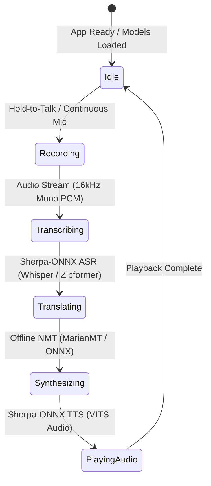

# EdgeTranslator

> **100% Offline, Real-Time On-Device Speech-to-Speech Translation Pipeline**

EdgeTranslator is a modern, privacy-first Flutter application engineered for air-gapped, low-latency, bidirectional speech-to-speech translation between English and Japanese. All machine learning inferences (ASR, NMT, and TTS) execute directly on device via ONNX Runtime without relying on external cloud APIs or an active internet connection.

---

## ⚡ Architecture & Pipeline



### Key Stages

| Stage | Engine / Library | Details |
| :--- | :--- | :--- |
| **Audio Capture** | [`record`](https://pub.dev/packages/record) | 16kHz 16-bit Mono Linear PCM streaming |
| **ASR (Speech-to-Text)** | [`sherpa_onnx`](https://pub.dev/packages/sherpa_onnx) | High-accuracy quantized Zipformer / Whisper streaming speech recognition |
| **NMT (Machine Translation)** | [`onnx_translation`](https://pub.dev/packages/onnx_translation) / MarianMT | Offline Neural Machine Translation with SentencePiece tokenization |
| **TTS (Text-to-Speech)** | [`sherpa_onnx`](https://pub.dev/packages/sherpa_onnx) | On-device VITS speech synthesis |
| **Audio Playback** | [`audioplayers`](https://pub.dev/packages/audioplayers) | Low-latency audio rendering |

---

## 🚀 Features

- **100% Offline & Private**: Zero data sent to the cloud; fully functional in airplane/air-gapped mode.
- **Bidirectional Translation**: English ⇄ Japanese real-time voice translation.
- **Reactive UI & Clean Architecture**: Built with Riverpod 3.x, featuring live pipeline steppers, interactive chat logs, and hold-to-talk controls.
- **Latency Telemetry**: Real-time profiling for audio capture, ASR inference, NMT translation, and TTS synthesis.

---

## 🛠️ Tech Stack

- **Framework**: [Flutter](https://flutter.dev) (Dart 3)
- **State Management**: [Riverpod 3](https://riverpod.dev)
- **Inference Runtime**: [ONNX Runtime](https://onnxruntime.ai/) & [Sherpa-ONNX](https://github.com/k2-fsa/sherpa-onnx)
- **Platforms**: Android, iOS, Windows, macOS, Linux

---

## 📦 Getting Started

### Prerequisites

- Flutter SDK (v3.12+ recommended)
- Android Studio / Xcode / Desktop C++ build tools

### Installation

```bash
git clone https://github.com/Sanidhyadatt/EdgeTranslator.git
cd EdgeTranslator
flutter pub get
flutter run
```

### Model Assets

Model binaries (`*.onnx`, `*.spm`) are excluded from Git tracking due to size constraints. Download or export your desired quantized models and place them into `assets/models/`:

- `assets/models/asr/` - Sherpa-ONNX Zipformer / Whisper encoder, decoder, and tokens.
- `assets/models/nmt/` - MarianMT ONNX weights and SentencePiece vocabularies.
- `assets/models/tts/` - VITS voice models and phoneme/lexicon dictionaries.

Refer to [`assets/models/README.md`](assets/models/README.md) for detailed model configuration instructions.

