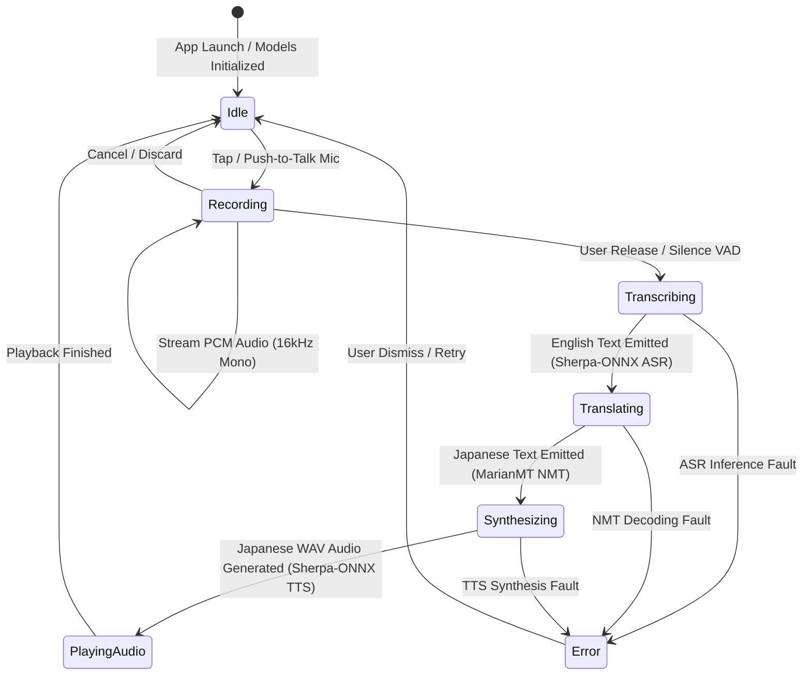

# Edge Translator: Offline Real-Time Translation Pipeline Implementation Plan

> **Goal**: 100% offline, air-gapped, real-time English-to-Japanese speech-to-speech translation running natively on-device with sub-second end-to-end latency.

---

## 1. System Architecture & Pipeline State Machine

The application is structured around a unidirectional, reactive state machine powered by **Riverpod 3.x**. The entire translation loop operates without network access, using quantized ONNX models running directly on CPU/NPU via native ONNX Runtime bindings.



---

## 2. Pipeline Stage Breakdown

| Stage | Technology / Engine | Input | Output | Target Latency |
| :--- | :--- | :--- | :--- | :--- |
| **1. Audio Capture** | `record: ^7.1.2` | Mic Hardware Input | 16kHz 16-bit Mono Linear PCM / WAV | Real-time stream |
| **2. Speech Recognition (ASR)** | `sherpa_onnx: ^1.13.8` (Zipformer / Whisper INT8) | Raw PCM Audio Samples | English Transcription Text | 100 – 180 ms |
| **3. Machine Translation (NMT)** | `onnx_translation: ^0.1.2` (MarianMT `opus-mt-en-jap`) | English Source Tokens | Japanese Translated Text | 70 – 120 ms |
| **4. Speech Synthesis (TTS)** | `sherpa_onnx: ^1.13.8` (Japanese VITS) | Japanese Text / Kana Tokens | Synthesized Japanese Audio WAV | 90 – 150 ms |
| **5. Audio Playback** | `audioplayers: ^6.8.1` | Local WAV Audio File | Speaker Output | Instant (< 20 ms) |

---

## 3. Riverpod State Machine Integration

### State Contract (`TranslationPipelineState`)
Managed by [`PipelineNotifier`](file:///c:/Users/Sanidhya%20Datt/Desktop/MyProjects/EasyTranslatorApp(NLP)/lib/providers/pipeline_notifier.dart):

```dart
class TranslationPipelineState {
  final PipelineStep currentStep; // idle, recording, speechToText, translation, textToSpeech, playing, error
  final String sourceText;        // Recognized English
  final String targetText;        // Translated Japanese
  final String? audioPath;        // Generated Japanese audio file
  final String? errorMessage;     // Non-null on failure
  final Map<String, int> latencyBreakdown; // Profiling telemetries per engine
}
```

### Thread Isolation & Concurrency Strategy
- **ASR & TTS**: Handled through Sherpa-ONNX's native C++ worker thread pool via FFI.
- **NMT**: Executed inside `Isolate.run()` to keep UI at 60/120 FPS during sequence decoding.

---

## 4. On-Device Model Asset Strategy

Models will be packaged and stored in [`assets/models/`](file:///c:/Users/Sanidhya%20Datt/Desktop/MyProjects/EasyTranslatorApp(NLP)/assets/models/):

```
assets/models/
├── asr/
│   ├── tokens.txt
│   ├── encoder.int8.onnx
│   ├── decoder.int8.onnx
│   └── joiner.int8.onnx
├── nmt/
│   ├── source.spm          (SentencePiece model for English)
│   ├── target.spm          (SentencePiece model for Japanese)
│   └── marian_en_ja.onnx   (Quantized MarianMT weights)
└── tts/
    ├── vits_jp.onnx
    ├── lexicon.txt
    └── tokens.txt
```

---

## 5. Phased Roadmap

### Phase 1: Foundation & Scaffold (Completed)
- [x] Initialized Flutter project `edge_translator`.
- [x] Installed `flutter_riverpod`, `record`, `audioplayers`, `sherpa_onnx`, `onnx_translation`.
- [x] Implemented Clean Architecture folder structure (`core/`, `features/`, `providers/`).
- [x] Designed responsive dark-mode UI with live state stepper and audio feedback cards.
- [x] Verified zero analysis errors (`flutter analyze`) and passing tests (`flutter test`).

### Phase 2: Asset Management & Storage Preparation
- [ ] Implement asset copier in [`ModelLoader`](file:///c:/Users/Sanidhya%20Datt/Desktop/MyProjects/EasyTranslatorApp(NLP)/lib/features/translation/data/datasources/model_loader.dart).
- [ ] Add model integrity verification (MD5/SHA256 checksums).

### Phase 3: Sherpa-ONNX Speech Recognition (ASR)
- [ ] Instantiate `OnlineRecognizer` in [`SherpaAsrServiceImpl`](file:///c:/Users/Sanidhya%20Datt/Desktop/MyProjects/EasyTranslatorApp(NLP)/lib/features/translation/data/datasources/sherpa_asr_service_impl.dart).
- [ ] Pipe recorded PCM buffers directly into the recognition stream.

### Phase 4: Offline MarianMT Translation (NMT)
- [ ] Wire [`OnnxNmtServiceImpl`](file:///c:/Users/Sanidhya%20Datt/Desktop/MyProjects/EasyTranslatorApp(NLP)/lib/features/translation/data/datasources/onnx_nmt_service_impl.dart) with `onnx_translation`.
- [ ] Tokenize English text using `source.spm` and decode Japanese text.

### Phase 5: Sherpa-ONNX Speech Synthesis (TTS) & Playback
- [ ] Instantiate `OfflineTts` in [`SherpaTtsServiceImpl`](file:///c:/Users/Sanidhya%20Datt/Desktop/MyProjects/EasyTranslatorApp(NLP)/lib/features/translation/data/datasources/sherpa_tts_service_impl.dart).
- [ ] Synthesize Japanese text into WAV audio and route to [`AudioPlayer`](file:///c:/Users/Sanidhya%20Datt/Desktop/MyProjects/EasyTranslatorApp(NLP)/lib/providers/service_providers.dart).

### Phase 6: Edge Optimization & UI Polishing
- [ ] Add Voice Activity Detection (VAD) for automatic speech cut-off.
- [ ] Battery and thermal profiling.
